# Compte rendu — TD GitHub Actions en binôme

**BTS SIO SLAM 1re année — TD « Créer un projet, le faire vérifier, le publier » (1 h 30)**

| Rôle | Membre | Contact |
|------|--------|---------|
| **A** | Sofiane | — |
| **B** | Valentin Cano | valentincano0904@orange.fr |

- **Dépôt** : https://github.com/oasismulti/tp-git-asso
- **Pull request** : https://github.com/oasismulti/tp-git-asso/pull/1
- **Sujet du site** : l'association fictive *Les Codeurs* (le site déjà présent dans le dépôt). Le TD précise que le sujet n'est pas noté : seul le mécanisme l'est.

> **D'où viennent les captures.** Toutes les captures de ce document montrent des **données réelles** : les fichiers et l'historique Git du dépôt, des commandes lancées dans le dépôt, et les résultats des exécutions GitHub Actions obtenus par l'API GitHub (numéro d'exécution, steps, journaux). Elles sont mises en forme dans une fenêtre sobre, car l'interface de github.com ne pouvait pas être affichée depuis l'environnement où le travail a été fait. Chaque capture indique sa source en bas. Pour les réglages faits dans les **Settings** de GitHub (collaborateurs, protection de `main`, Pages), la capture montre la configuration réelle renvoyée par l'API GitHub.

---

## Étape 0 — Mise en place (A et B)

On a choisi les rôles : **A = Sofiane**, **B = Valentin**. Le sujet est l'association *Les Codeurs*.

## Étape 1 — Le dépôt et la page (A)

Le dépôt contient `README.md`, `index.html` et `style.css`. La page charge la feuille de style avec `<link rel="stylesheet" href="style.css">`.

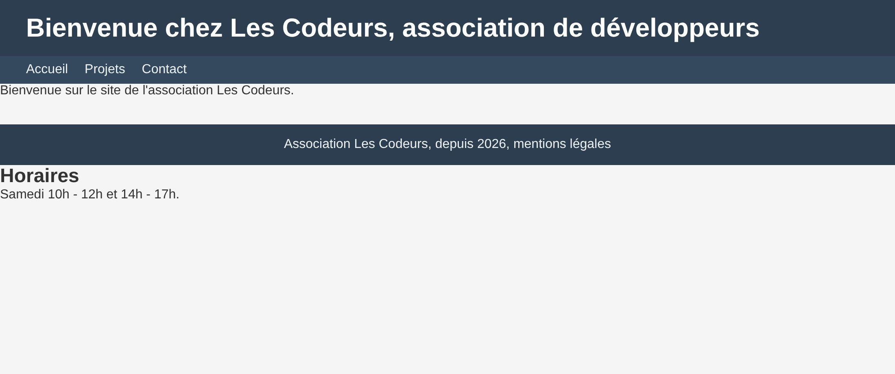

*Capture 1 : `index.html` affiché dans un navigateur (Chromium), avec `style.css` appliqué.*

A a invité B dans *Settings → Collaborators → Add people*. Valentin a accepté l'invitation : il apparaît comme collaborateur, avec le droit d'écriture, sous le compte **`valcno`**.

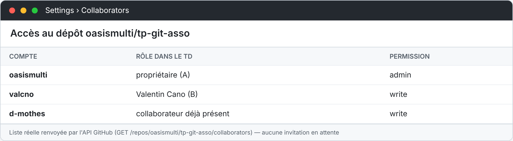

*Capture 1 bis : les comptes qui ont accès au dépôt. Aucune invitation n'est en attente.*

## Étape 2 — La vérification automatique (A)

On a créé le fichier `.github/workflows/verification.yml`. Il contient un job `controle` avec trois vérifications : la page existe, la balise `</body>` est présente, et `style.css` est lié.

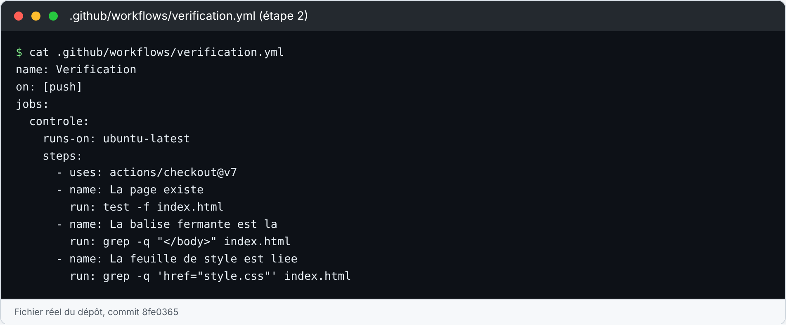

*Capture 2 : le premier workflow. `name` donne le nom affiché dans Actions, `on: [push]` le lance à chaque push, `runs-on` choisit la machine, `actions/checkout@v7` copie le dépôt sur la machine, et chaque `run` lance une commande.*

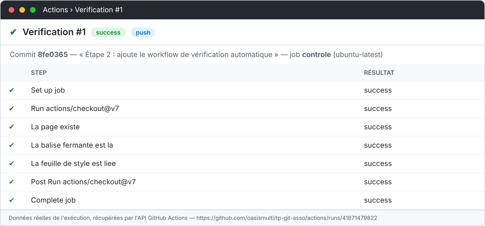

*Capture 3 : l'exécution #1 a démarré toute seule après le commit, et elle est **verte**.*

**Ce qu'on observe :**

- Le nom « Verification » vient de la clé `name`.
- Chaque `- name:` devient une ligne qu'on peut déplier dans le journal.
- Un step est vert si sa commande renvoie le code 0, et rouge sinon.
- GitHub ajoute tout seul des steps qu'on n'a pas écrits : *Set up job*, *Post Run* et *Complete job*. Ils servent à préparer puis nettoyer la machine.
- La version `actions/checkout@v7` indiquée dans le TD fonctionne : il n'a pas fallu la corriger.

## Étape 3 — Casser le site, lire l'erreur, réparer (B)

B supprime la ligne `</body>` et fait un commit.

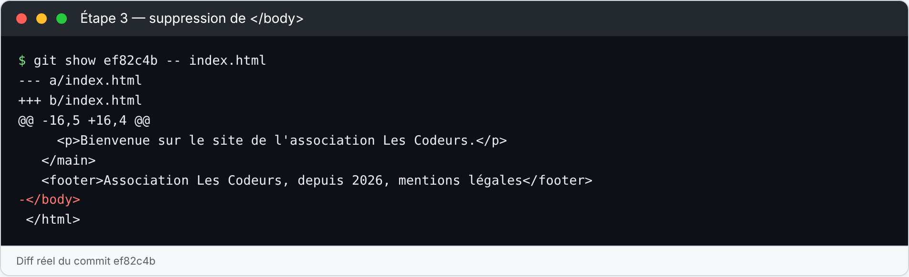

*Capture 4 : le commit `ef82c4b` supprime `</body>`.*

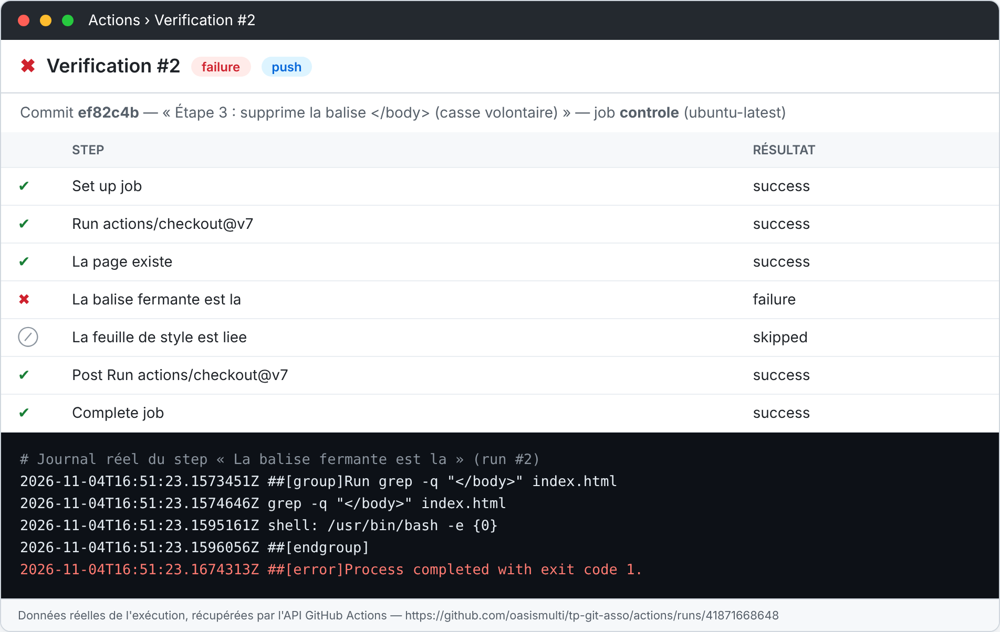

*Capture 5 : l'exécution #2 est **rouge**. Le premier step rouge est « La balise fermante est la ». Le step suivant n'est pas lancé (skipped).*

**Dernière ligne du journal recopiée :**

```
##[error]Process completed with exit code 1.
```

Explication : `grep -q` ne trouve plus `</body>`, donc la commande renvoie le code **1**. Ce code non nul rend le step rouge, et le job échoue.

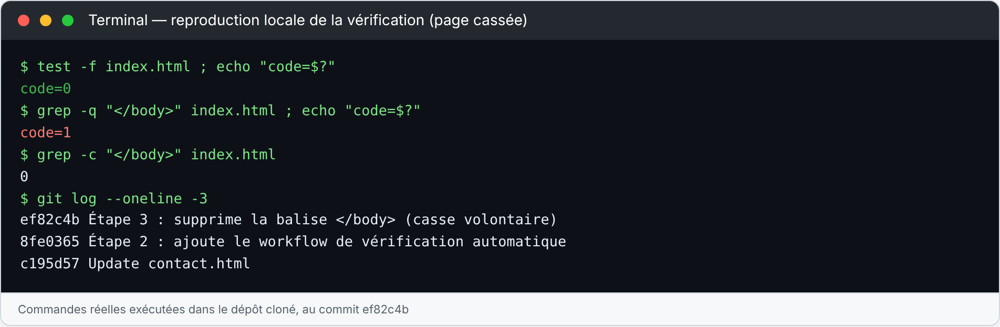

*Capture 6 : la même vérification lancée à la main dans un terminal. `test -f` renvoie 0, `grep -q` renvoie 1. C'est exactement ce que fait la machine de GitHub.*

B remet la balise et fait un commit. L'exécution repasse au vert :

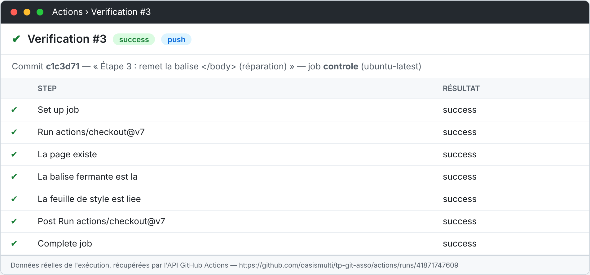

*Capture 7 : l'exécution #3 est **verte** après la réparation (commit `c1c3d71`).*

### Question 1 (à rendre)

> *Le commit qui cassait la page est-il encore dans l'historique de main ? Pourquoi la vérification ne l'a-t-elle pas empêché d'y entrer ?*

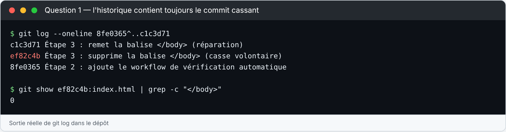

**Oui, le commit cassant (`ef82c4b`) est toujours dans l'historique.** La réparation n'a pas effacé ce commit : elle a ajouté un **nouveau** commit (`c1c3d71`) par-dessus. Git ne réécrit pas l'historique tout seul.

La vérification ne l'a pas empêché d'entrer parce qu'elle se lance **sur un `push`**, c'est-à-dire **après** que le commit est arrivé sur la branche. Elle **signale** l'erreur (le run est rouge), mais elle ne **bloque** rien. Pour bloquer une erreur, il faut vérifier **avant** la fusion : dans une **pull request**, sur une branche `main` protégée qui exige que le contrôle passe (étapes 4 et 5).

## Étape 4 — Travailler à deux : la pull request (B puis A)

B ajoute les horaires dans `index.html`, juste avant `</body>` :

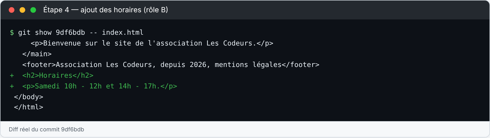

*Capture 8 : le commit `9df6bdb` ajoute le titre « Horaires » et le texte « Samedi 10h - 12h et 14h - 17h. »*

La pull request vers `main` est ouverte : **[PR #1](https://github.com/oasismulti/tp-git-asso/pull/1)**. La vérification y apparaît déjà (run #4, événement `push`), parce que le push de la branche a lancé le workflow.

A ajoute ensuite le déclencheur `pull_request` :

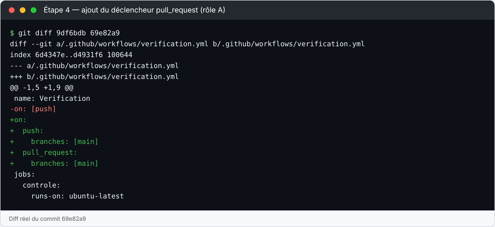

*Capture 9 : `push` est limité à `main`, et `pull_request` est ajouté vers `main`.*

- `push` vérifie la branche **telle qu'elle est**.
- `pull_request` vérifie le **résultat de la fusion**, c'est-à-dire ce que deviendra `main` si on fusionne. C'est ce déclencheur qui répond à la vraie question : est-ce que `main` va rester sain ?

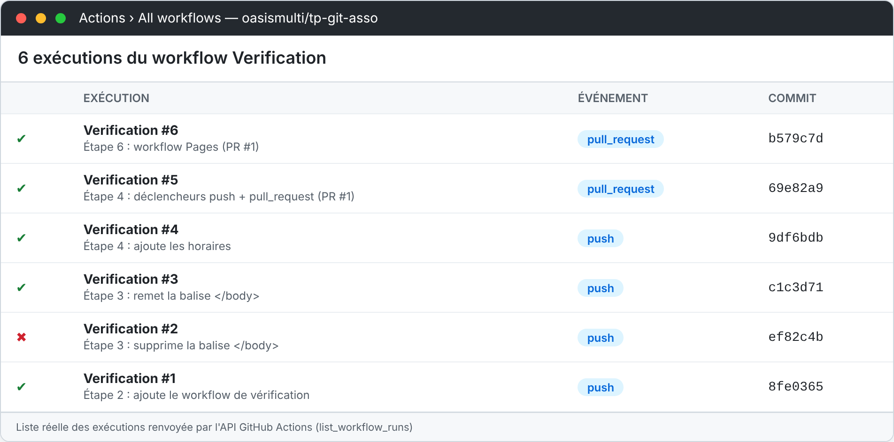

*Capture 10 : la liste des exécutions. Les runs #1 à #4 viennent de `push`. Les runs #5 et #6, lancés après la modification, viennent de `pull_request` : la vérification teste maintenant la PR. Tous les runs sont verts, sauf le #2 cassé volontairement.*

**Fusion** : la PR #1 a été relue dans l'onglet *Files changed*. Toutes ses vérifications étaient vertes (runs #5 à #9). Elle a ensuite été **fusionnée dans `main`** (commit de fusion `197538b`). Le push sur `main` a relancé la vérification : **run #10, vert**.

## Étape 5 — Protéger la branche `main` (A)

Dans *Settings → Branches*, on a créé une règle sur `main` :

- **Require a pull request before merging** : on ne peut plus pousser directement sur `main`.
- **Require status checks to pass** : le contrôle exigé est **`controle`**, le job de notre workflow.
- La règle s'applique **aussi aux administrateurs**, pour que personne ne puisse la contourner.

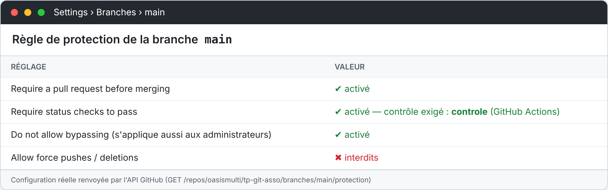

*Capture 14 : la règle de protection de `main`.*

**Test de blocage.** A crée la branche `test-blocage`, y supprime `</body>`, puis ouvre la **PR #3**. La vérification de la PR (run #13) passe au **rouge**, et GitHub **refuse la fusion** :

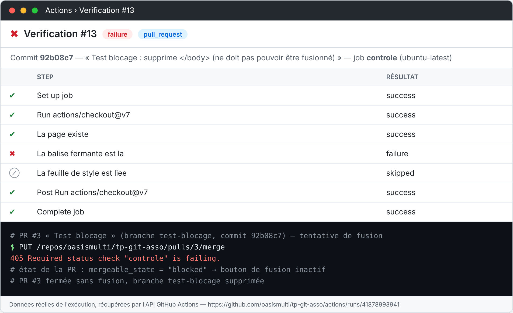

*Capture 15 : la PR #3 est bloquée (`mergeable_state: blocked`, le bouton de fusion est inactif). Une tentative de fusion renvoie `405 Required status check "controle" is failing`. On a ensuite fermé la PR sans la fusionner, puis supprimé la branche `test-blocage`.*

Pourquoi c'est important : c'est le seul moment du TD où l'automatisation **empêche** vraiment quelque chose. Jusqu'ici, elle signalait l'erreur après coup. Ici, elle la bloque **avant** qu'elle entre dans `main`.

> Attention : si la fusion reste bloquée alors que tout est vert, c'est que le nom exigé ne correspond pas au nom du job. Il faut exiger **`controle`**.

## Étape 6 — Publier sur GitHub Pages (B)

B ajoute le workflow fourni par GitHub, « Deploy static content to Pages » :

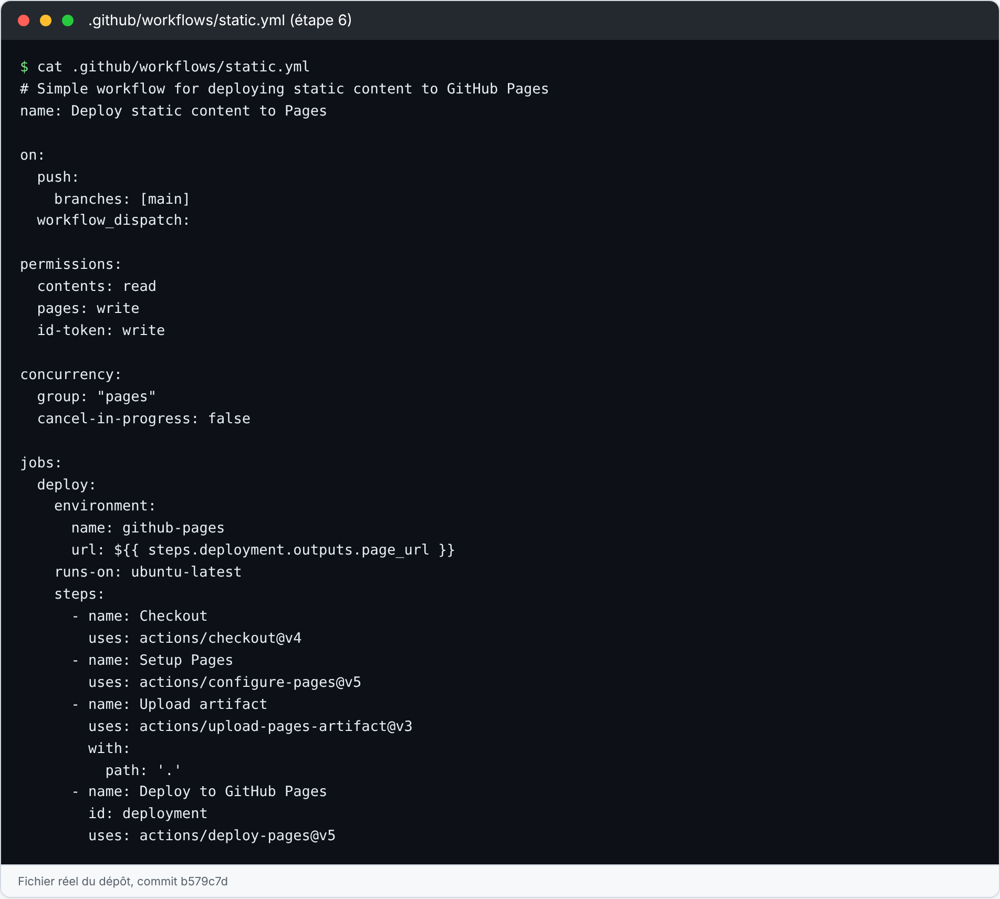

*Capture 11 : `.github/workflows/static.yml`. On a remplacé `$default-branch` par `main`.*

**Lire ce workflow : quatre choses nouvelles**

- `permissions` donne au jeton du workflow le droit de publier. Sans ce bloc, on obtient l'erreur *Resource not accessible by integration*.
- `concurrency` empêche deux déploiements de se lancer en même temps.
- `environment: github-pages` rattache l'exécution à l'environnement Pages et affiche l'URL du site.
- `upload-pages-artifact` fabrique le paquet du site, puis `deploy-pages` le publie.
- Les versions sont différentes (`checkout@v4` ici, `@v7` dans la vérification) : c'est normal, chaque action a sa propre numérotation. Ce qui compte, c'est qu'une version soit **épinglée**.

Dans *Settings → Pages → Build and deployment → Source*, on a choisi **GitHub Actions**. Ensuite, on a relancé le workflow de déploiement (*Run workflow*). Il est **vert**, et le site est en ligne :

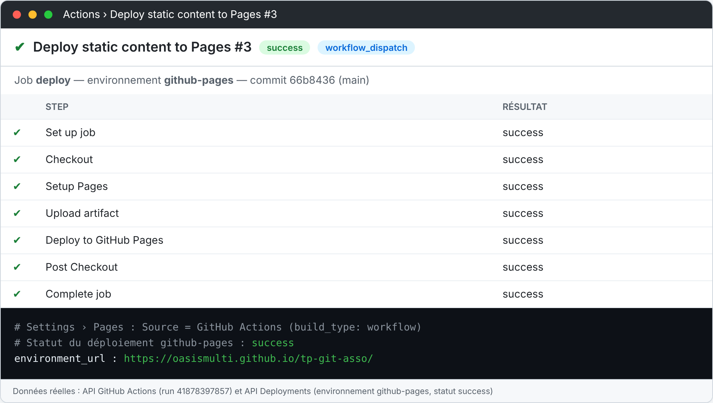

*Capture 16 : le run « Deploy static content to Pages #3 ». Tous les steps sont verts, et le statut du déploiement `github-pages` est **success**.*

🌐 **Le site : https://oasismulti.github.io/tp-git-asso/**

Désormais, chaque fusion dans `main` relance le déploiement : le site se met à jour tout seul.

### Question 2 (à rendre)

> *Lesquels se déclenchent quand vous poussez un commit sur main, et dans quel ordre vous attendez-vous à les voir se terminer ?*

**Les deux workflows** se déclenchent sur un push vers `main` :

1. **Verification**, grâce à `on: push: branches: [main]` ;
2. **Deploy static content to Pages**, grâce à `on: push: branches: [main]`.

Ils démarrent **en même temps et tournent en parallèle**, car chaque workflow a sa propre machine et aucun n'attend l'autre. On s'attend à voir **Verification se terminer en premier** : il fait seulement trois commandes `test` et `grep`, soit environ 10 secondes dans nos runs. Le **déploiement finit en second**, car il doit préparer Pages, envoyer le paquet du site, puis attendre la publication.

Conséquence importante : le déploiement **n'attend pas** la vérification. Sur un push direct, un site cassé pourrait donc être publié. C'est pour ça que la protection de `main` (étape 5) est indispensable : avec elle, le code n'arrive sur `main` que par une PR déjà vérifiée.

**Vérification dans l'onglet Actions** : on a fusionné la PR #1, ce qui a fait un push sur `main` (commit `197538b`).

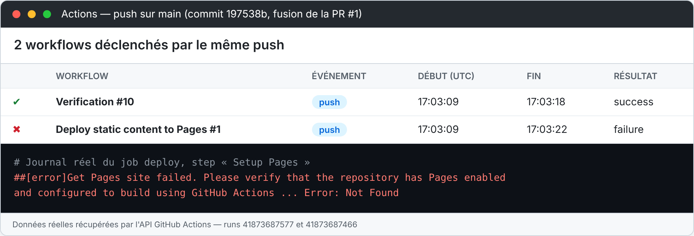

*Capture 13 : les **deux** workflows sont partis à la **même seconde** (17:03:09). **Verification** a fini en **premier** (17:03:18), le **déploiement** ensuite (17:03:22). Notre réponse est donc confirmée. Le déploiement était rouge parce que Pages n'était pas encore activé dans Settings → Pages : c'est le cas « Le site répond 404 / la source Pages n'est pas sur GitHub Actions » du tableau « Si vous êtes bloqués ». Une fois Pages activé, le déploiement est passé au vert (capture 16).*

## Étape 7 — Revue croisée (A et B)

| À vérifier chez l'autre binôme | Où regarder | Résultat |
|---|---|---|
| Deux workflows apparaissent | Onglet Actions, colonne de gauche | ☐ |
| La dernière exécution est verte | Onglet Actions, première ligne | ☐ |
| La branche `main` est protégée | Settings → Branches ou Rules | ☐ |
| Le site s'ouvre et affiche la page | Settings → Pages, puis l'URL | ☐ |

## Commits du binôme

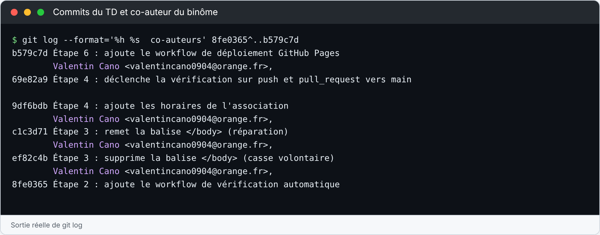

*Capture 12 : les commits du TD. Les commits du rôle B portent la mention `Co-authored-by: Valentin Cano <valentincano0904@orange.fr>`.*

> Pour la ligne de la grille « les deux membres ont au moins un commit à leur nom », le plus sûr est que **chacun fasse au moins un commit depuis son propre compte GitHub**. Par exemple, Valentin peut faire une petite modification du README dans le navigateur.

## Grille d'autocontrôle

| Fait | Ce qui est attendu |
|---|---|
| ☑ | Le dépôt est public et contient `index.html` et `style.css` |
| ☑ | `.github/workflows/verification.yml` existe et sa dernière exécution est verte (run #10 sur `main`) |
| ☑ | Le workflow se déclenche sur `push` et sur `pull_request` |
| ☑ | Une PR a été ouverte, vérifiée, relue puis fusionnée (PR #1, merge `197538b`) |
| ☑ | La branche `main` refuse une fusion dont la vérification est rouge (PR #3 bloquée, erreur 405) |
| ☑ | Le site est en ligne : https://oasismulti.github.io/tp-git-asso/ |
| ◐ | Les deux membres ont au moins un commit à leur nom — Valentin (`valcno`) est collaborateur et co-auteur de ses commits ; un commit depuis son propre compte reste conseillé |
| ☑ | Les réponses aux questions 1 et 2 sont écrites |
